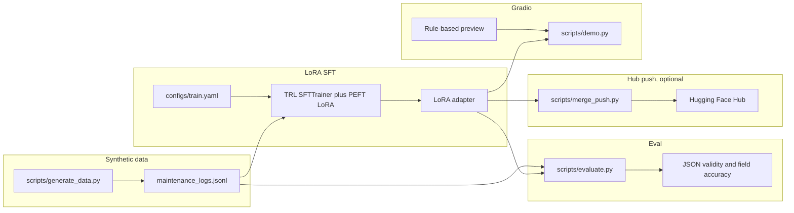

# LoRA fine-tune: maintenance logs to JSON

Portfolio demo by Arpan Bom. A small supervised fine-tuning pipeline that turns a maintenance log into one JSON object with [Hugging Face](https://huggingface.co/) `transformers`, `peft`, `datasets`, and `trl`.

The training set is **synthetic**. It is produced by a seeded generator and every row says so. The default train config points at `Qwen/Qwen2.5-0.5B-Instruct`. `HuggingFaceTB/SmolLM2-360M-Instruct` is a drop-in `model_name_or_path` if you would rather start there. This repo does not check in trained weights or measured scores.

## Architecture



`scripts/merge_push.py` reads `HF_TOKEN` and is left out of CI. The Gradio app opens on a rule-based preview of the labeled synthetic format. That preview is a regex parser for the demo, and it is labeled as such in the UI.

## Schema

Each target object has `asset_id`, `site`, `reported_at`, `severity`, `component`, `symptom`, `action_taken`, `downtime_minutes`, `status`, and `technician`.

`severity` is `low`, `medium`, `high`, or `critical`. `status` is `open`, `in_progress`, or `resolved`. `downtime_minutes` is a non-negative integer. `reported_at` is a UTC timestamp like `2024-03-12T08:15:00Z`.

A synthetic log carries those values in labeled text. The assistant target is the canonical JSON object.

## Metrics

Defined in `maintlog.metrics` and computed only when you run eval:

- **JSON validity** — fraction of predictions that contain a JSON object.
- **Field accuracy** — mean, over examples, of how many required fields match. An unparsable prediction scores 0 on every field. `severity` and `status` are compared case-insensitively. Other strings are stripped and compared exactly. `downtime_minutes` also accepts a whole-number float or a digit string.

## Results

No quality run is stored in this repo. The table is a placeholder.

| Split | JSON validity | Field accuracy |
| --- | --- | --- |
| eval | — | — |

The same empty cells live in [`results/eval_results.json`](results/eval_results.json). Running `scripts/evaluate.py` writes `results/latest_eval.json` and leaves the placeholder alone.

## Run it

```bash
python -m venv .venv
source .venv/bin/activate
pip install --upgrade pip
pip install torch --index-url https://download.pytorch.org/whl/cpu
pip install -e ".[dev]"

python scripts/generate_data.py --config configs/data.yaml
python scripts/train.py --config configs/train.yaml
python scripts/evaluate.py --config configs/eval.yaml
python scripts/demo.py
```

The demo listens on `http://127.0.0.1:18765`. Training `Qwen2.5-0.5B-Instruct` downloads that model from the Hub and is slow on CPU. `configs/train.yaml` is the config for that run. CI uses `configs/smoke.yaml` instead.

Merge the adapter and push it only when you have a token. Change `repo_id` in `configs/merge.yaml` first. The upload is private by default.

```bash
HF_TOKEN=hf_... python scripts/merge_push.py --config configs/merge.yaml
python scripts/merge_push.py --config configs/merge.yaml --merge-only
```

`--merge-only` writes the merged model locally and does not read `HF_TOKEN`.

## Test it

```bash
pytest -q
```

The suite covers the generator, the JSONL loader, the metric math, config parsing, the demo preview, and the missing-token guard on the Hub script. One test runs two LoRA steps on CPU with `hf-internal-testing/tiny-random-LlamaForCausalLM`. That test checks that training finishes and the loss is finite. It is a smoke test of the loop, and it is not a quality claim.

GitHub Actions runs the same `pytest -q` command. Origin does not run Actions. The workflow does not call the merge script.

## Portfolio demo

This is a portfolio project for Arpan Bom's CV. The logs are synthetic, the results table is empty, and the tiny-model test only proves the training step runs. Use it as a starting point for a real fine-tune, and measure that run yourself.

## License

MIT. See [LICENSE](LICENSE).
